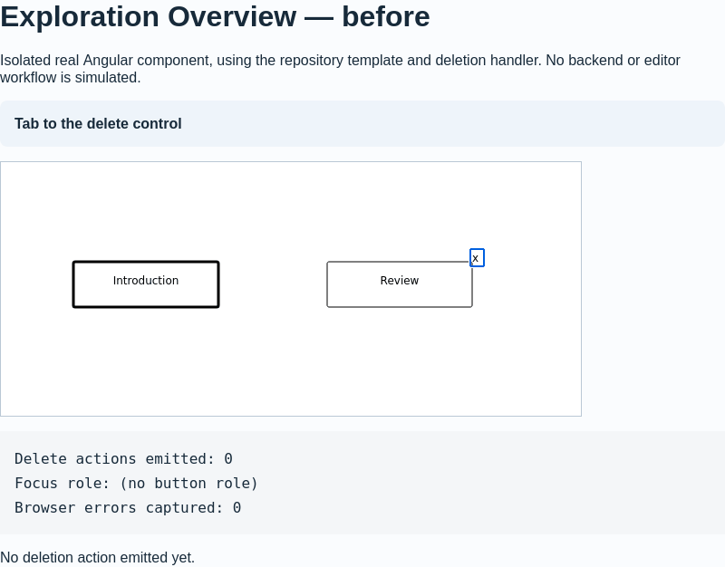
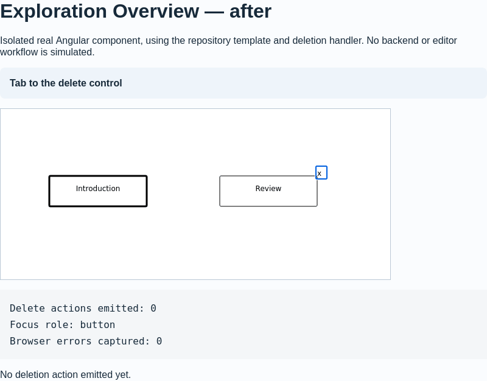

# Oppia #27784 verification evidence

Patch: [8a9b07dd595dd9d68fd0fd56ebeca63cafb55ec3](https://github.com/sahaja9707/oppia/commit/8a9b07dd595dd9d68fd0fd56ebeca63cafb55ec3).
Baseline template: [bc73ecf9cf71d53d0849f61017d8990ae25aec00](https://github.com/oppia/oppia/commit/bc73ecf9cf71d53d0849f61017d8990ae25aec00).

## Browser demonstration

These captures render the actual `StateGraphVisualization` Angular component and its actual deletion handler in a test host. The baseline and patched HTML templates are compiled separately with identical fixture data and actions. Backend services and graph layout data are mocked. This is an isolated component demonstration, not a full exploration-editor or NVDA session.

Browser: Firefox 142.0.1, supplied by Playwright 1.56.1. The issue's Firefox 158 environment was not tested.

| Activation on the delete control | Before | After |
| --- | --- | --- |
| Reached with Tab | Yes | Yes |
| Exposed as named button | No | Yes |
| Native Enter | One delete output | One delete output |
| Click dispatched on the focused element | No output | One delete output |
| Native Space press/release | No output | One delete output |
| Pointer click on the rectangle hit target | One delete output | One delete output |

The focusable SVG text previously had an Enter handler, but no button role or click handler. The pointer click handler was on the sibling rectangle. The new group gives focus, semantics, keyboard handlers, and click handling to one control. Space activates on keyup and its keydown prevents scrolling.

The demo logs the real `onDeleteFunction` outputs; it does not pretend to run the parent editor's confirmation or deletion workflow. Browser exceptions and console errors are captured and asserted to be zero. Machine-readable results are in [browser-results.json](browser-results.json).

Before:



After:



## Automated validation

- Chrome Headless 102.0.5005.61: 13 component tests passed; Oppia's frontend coverage checker passed; command exited 0.
- Firefox 142.0.1: the same 13 component tests passed; Angular/Karma command exited 0. Firefox was connected using Playwright because the standard Firefox launcher timed out under WSL.
- ESLint passed for the changed template and spec.
- HTMLLint reported zero errors for the template.
- Oppia's custom HTML tag/attribute check passed.
- Prettier formatting checked for the spec.
- Git whitespace check passed.

The component suites retain their existing `ExplorationDataService` fixture log about `/context.html`. Both runners reported 13 successes and exited 0. The separate browser demonstration mocks that service and checks for zero browser errors.

The Chrome command was:

```sh
python -m scripts.run_frontend_tests --specs_to_run=core/templates/pages/exploration-editor-page/editor-tab/graph-directives/state-graph-visualization.component.spec.ts --check_coverage --verbose
```

Full runner logs are in [chrome-tests.log](chrome-tests.log) and [firefox-tests.log](firefox-tests.log). The local demonstration spec and browser controller are included for inspection.
