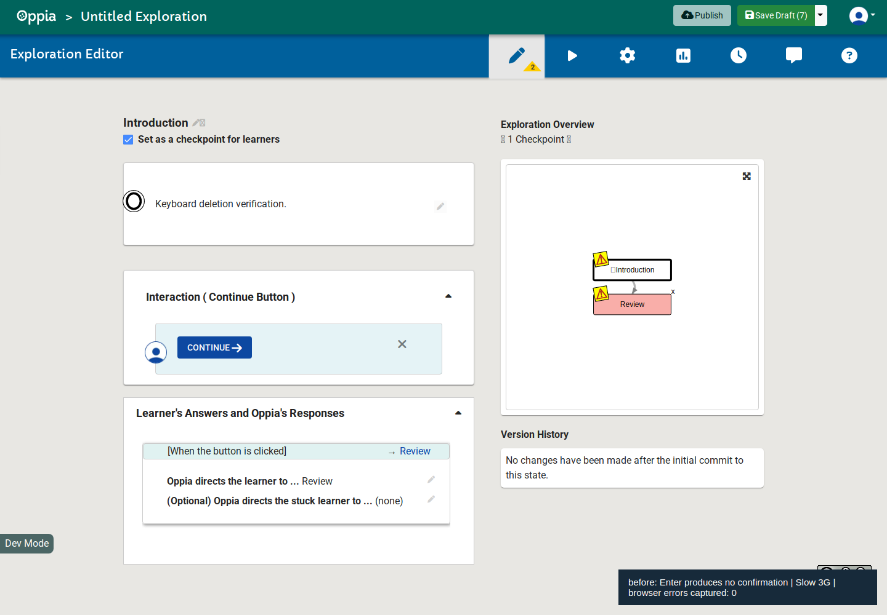
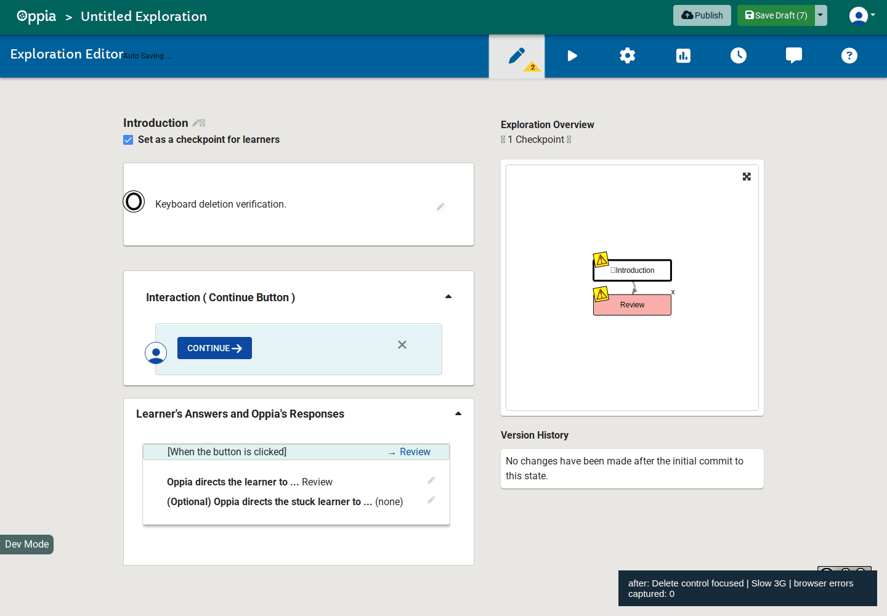

# Oppia #27784 verification evidence

Source patch: [edf19996a02e64dd45214229383ac82e1f891bf4](https://github.com/sahaja9707/oppia/commit/edf19996a02e64dd45214229383ac82e1f891bf4).
Baseline: [bc73ecf9cf71d53d0849f61017d8990ae25aec00](https://github.com/oppia/oppia/commit/bc73ecf9cf71d53d0849f61017d8990ae25aec00).

## Full editor verification

The screenshots use the actual local Oppia backend and exploration editor, with two cards created through its normal UI. Chrome 102.0.5005.61 used Slow 3G network throttling. These captures do not use mocked editor services.

The baseline screenshot shows that Enter leaves the confirmation closed. The updated recording shows Tab reaching the named delete button, Enter opening a persistent confirmation, and confirming deletion removing Review while Introduction remains. Preventing Enter's default action stops the newly focused Cancel button from immediately dismissing the confirmation.

Before:



After:



[Machine-readable result](full-editor-results.json) records focus, button role, confirmation, removal, and zero captured browser or HTTP errors. The successful after-only run is the scope of this result. [Browser controller](full-editor-smoke.js) includes the setup and assertions.

## Automated validation

- Chrome Headless 102.0.5005.61: 13 component tests passed; Oppia's frontend coverage checks passed; runner exited 0.
- Firefox 142.0.1: the same 13 component tests passed; runner exited 0. Firefox was captured through Playwright because the standard launcher timed out under WSL. Its log includes a disconnect notice during server shutdown after all tests passed.
- ESLint, HTMLLint, Oppia's custom HTML checks, Prettier, and Git whitespace checks passed for the changed files.

Tests cover focus, button role and name, Enter and Space activation, prevention of both default key actions, Space release timing, ignored Escape, and pointer/synthesized clicks. Existing component fixture logs about ExplorationDataService at /context.html appear in both suites; both runners exited 0.

The Chrome command was:

```sh
python -m scripts.run_frontend_tests --specs_to_run=core/templates/pages/exploration-editor-page/editor-tab/graph-directives/state-graph-visualization.component.spec.ts --check_coverage --verbose
```

Logs: [Chrome](chrome-tests.log), [Firefox](firefox-tests.log). No NVDA or Firefox 158 session was performed. Upstream GitHub CI remains subject to maintainer approval and the contributor's CLA; these results describe local validation only.
